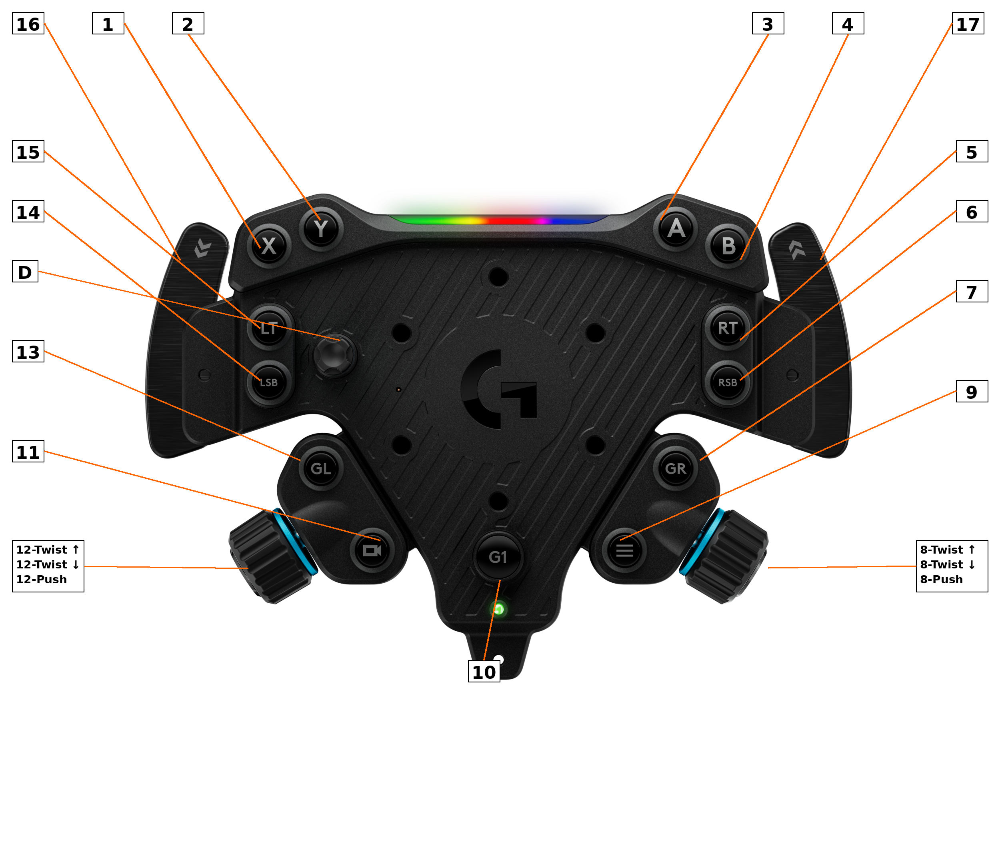

# Button Mapping

This page lists the physical controls on the RS50 / G PRO wheel and hub. It
gives the joystick button index each one reports. Buttons use sequential
indices that match Windows DirectInput (the Windows game-input interface).
So bindings stay the same across platforms.

This is the reference for binding controls in a game. The wire-level bitmask
(which report bit encodes which button) is in
[PROTOCOL_SPECIFICATION.md](PROTOCOL_SPECIFICATION.md). The G923 has its own
table below. It reports its own classic button layout straight from its HID
descriptor (the device's own list of its controls), not the RS50/G PRO one.

The **Index** column is the joystick button number games show when binding
(sequential, matching Windows DirectInput). The **Diagram #** column is the
numbered callout box in the layout image above. The two numbering systems
are unrelated. So a button's index and its diagram number usually differ.

| Index | Button | Diagram # |
|-------|--------|-----------|
| 0 | A | 3 |
| 1 | X | 1 |
| 2 | B | 4 |
| 3 | Y | 2 |
| 4 | Right Paddle / Gear Right | 17 |
| 5 | Left Paddle / Gear Left | 16 |
| 6 | RT (Right Trigger) | 5 |
| 7 | LT (Left Trigger) | 15 |
| 8 | Camera / View | 11 |
| 9 | Menu | 9 |
| 10 | RSB (Right Stick) | 6 |
| 11 | LSB (Left Stick) | 14 |
| 21 | Right Encoder CW | 8 |
| 22 | Right Encoder CCW | 8 |
| 23 | Right Encoder Push | 8 |
| 24 | Left Encoder CW | 12 |
| 25 | Left Encoder CCW | 12 |
| 26 | Left Encoder Push | 12 |
| 27 | G1 (Logitech logo) | 10 |
| 28 | GL | 13 |
| 29 | GR | 7 |

GL and GR are their own buttons, not aliases of the shifter paddles. This
was hardware-verified on 2026-07-20 by guided capture: evdev 0x2cc / 0x2cd,
sequential after G1. evdev is the Linux input event interface.

The D-pad reports as a hat switch (`ABS_HAT0X` / `ABS_HAT0Y`), not as four
buttons. It is diagram callout "D".

## RS H-Shifter (046d:c26b)

### Connected to the Wheel Base

When you connect the shifter to a wheel base accessory port, gears 1 to 7
and Reverse report on DirectInput button indices 12 to 20
(hardware-verified 2026-10-29 and 2026-11-09). Index 19 is not used. A DB9
Driving Force Shifter on the Racing Adapter reports its Reverse on the same
index 20.

| Index | Button / Gear | evdev Code | Wire bitmask (Report 0x08) |
|---|---|---|---|
| 12 | RS H-Shifter: Gear 1 | `0x12c` (`BTN_BASE`) | Byte 2 bit 0 (`0x01`) |
| 13 | RS H-Shifter: Gear 2 | `0x12d` (`BTN_BASE2`) | Byte 2 bit 1 (`0x02`) |
| 14 | RS H-Shifter: Gear 3 | `0x12e` (`BTN_BASE3`) | Byte 2 bit 2 (`0x04`) |
| 15 | RS H-Shifter: Gear 4 | `0x12f` (`BTN_BASE4`) | Byte 2 bit 3 (`0x08`) |
| 16 | RS H-Shifter: Gear 5 | `0x2c0` (`BTN_TRIGGER_HAPPY1`) | Byte 2 bit 4 (`0x10`) |
| 17 | RS H-Shifter: Gear 6 | `0x2c1` (`BTN_TRIGGER_HAPPY2`) | Byte 2 bit 5 (`0x20`) |
| 18 | RS H-Shifter: Gear 7 | `0x2c2` (`BTN_TRIGGER_HAPPY3`) | Byte 2 bit 6 (`0x40`) |
| 19 | not used | `0x2c3` (`BTN_TRIGGER_HAPPY4`) | Byte 2 bit 7 (`0x80`) |
| 20 | RS H-Shifter: Reverse (also Racing Adapter DB9 Reverse) | `0x2c4` (`BTN_TRIGGER_HAPPY5`) | Byte 3 bit 0 (`0x01`) |

### Connected Directly to PC via USB

When you connect the shifter directly to the PC via USB
(`046d:c26b Logitech RS H-Shifter`), it enumerates as an independent
joystick. It reports 8 digital buttons:
- Buttons 0 to 6 (`0x120`..`0x126`): 1st through 7th gear
- Button 7 (`0x127`): Reverse (R)

## RS Shifter & Handbrake (046d:c278)

Dual-mode sim accessory featuring a physical toggle switch between progressive analog handbrake mode and dual-direction sequential shifter mode.

### Connected to the Wheel Base

When connected to a direct-drive wheel base accessory port (RS50 / G PRO):
- **Handbrake Mode**: Reports as the wheel base's handbrake axis (progressive 0 to 100%).
- **Sequential Shifter Mode**: Shift Up (pull back) and Shift Down (push forward) are routed directly by base firmware to the wheel paddle button codes:
  - Shift Up: Right Paddle (`0x124`, `BTN_TOP2`)
  - Shift Down: Left Paddle (`0x125`, `BTN_PINKIE`)

### Connected Directly to PC via USB

When connected directly to the PC via USB-C (`046d:c278 Logitech RS Shifter & Handbrake`), it enumerates as a standalone joystick:
- **Handbrake Mode**: Progressive 10-bit analog axis:
  - `ABS_Z`: Handbrake lever travel (`0` relaxed .. `1023` fully pulled).
- **Sequential Shifter Mode**: Two digital momentary buttons:
  - Button 0 (`0x120`, `BTN_TRIGGER`): Shift Up (pull back)
  - Button 1 (`0x121`, `BTN_THUMB`): Shift Down (push forward)

## Logitech G Racing Adapter (046d:c273)

USB adapter connecting legacy G29/G920/G923 3-pedal sets and 6+R DB9 Driving Force shifters.

### Pedals (12-bit Analog Axes)

Connected via the adapter's dedicated pedal port:
| Pedal | evdev Axis | Raw Range | Notes |
|-------|------------|-----------|-------|
| Throttle | `ABS_Y` | `0`..`4095` | Full travel 12-bit progressive |
| Brake | `ABS_Z` | `0`..`4095` | Full travel 12-bit progressive |
| Clutch | `ABS_RX` | `0`..`4095` | Full travel 12-bit progressive |

### DB9 Driving Force Shifter (Digital Buttons)

Connected via the adapter's DB9 shifter port when the adapter is plugged directly into the PC via USB:
| Gear | evdev Code | DirectInput Button |
|------|------------|--------------------|
| 1st Gear | `0x120` (`BTN_TRIGGER`) | Button 0 |
| 2nd Gear | `0x121` (`BTN_THUMB`) | Button 1 |
| 3rd Gear | `0x122` (`BTN_THUMB2`) | Button 2 |
| 4th Gear | `0x123` (`BTN_TOP`) | Button 3 |
| 5th Gear | `0x124` (`BTN_TOP2`) | Button 4 |
| 6th Gear | `0x125` (`BTN_PINKIE`) | Button 5 |
| Reverse (Push-down + 6th) | `0x126` (`BTN_BASE`) | Button 6 |

### Connected to the Wheel Base

When the Racing Adapter is plugged into an RS50 / G PRO wheel base USB port (`wheel_accessory` reports `Racing Adapter`):
- **Pedals**: Routed through the wheel base's standard pedal axes (`ABS_RX` Throttle, `ABS_RY` Brake, `ABS_RZ` Clutch).
- **DB9 Driving Force Shifter**: Routed through the wheel base's standard H-shifter button slots (`0x12c`..`0x12f` for 1st to 4th, `0x2c0`..`0x2c1` for 5th to 6th, and `0x2c4` (`BTN_TRIGGER_HAPPY5`) for Reverse, hardware-verified 2026-11-09). In Desktop mode (`profile 0`), the kernel driver automatically enables `0x8120` (`GAMING_ATTACHMENTS`) slot routing and `0x1BC0` (`SYNC`) when the Racing Adapter sub-device is detected.

## Pedals Connected to Wheel Base

When pedals (and optional RS Shifter & Handbrake) are connected to a wheel base's ports, the evdev axis assignment depends on the wheel model (matching `pedal_axes` in `logi_wheel_core::evtest` and `HIDPP_DD_PEDAL_BASE_AXIS` in `hid-logitech-hidpp.c`):
| Axis | RS50 / G PRO | G923 (PlayStation `0xc266`/`0xc267`) | G923 (Xbox `0xc26e`) |
|------|--------------|--------------------------------------|----------------------|
| Throttle | `ABS_RX` | `ABS_Z` | `ABS_Y` |
| Brake | `ABS_RY` | `ABS_RZ` | `ABS_Z` |
| Clutch | `ABS_RZ` | `ABS_Y` | `ABS_RZ` |
| Handbrake | `ABS_Z` | - | - |

## G923

This is the G923's own button layout. It was hardware-captured on
2026-07-27 by a guided live capture on a PS-edition unit (PID 0xc266, the
USB product id). Every physical button was pressed in turn, and its
joystick index recorded. The G923 reports the same sequential DirectInput
indexing as the RS50/G PRO above, but a different set of buttons. It has no
G1/GL/GR. It has only one dial (right hand); the G923 has no left encoder
at all.

| Index | Button |
|-------|--------|
| 0 | X |
| 1 | Square |
| 2 | Circle |
| 3 | Triangle |
| 4 | Right Paddle |
| 5 | Left Paddle |
| 6 | R2 |
| 7 | L2 |
| 8 | Share |
| 9 | Options |
| 10 | R3 |
| 11 | L3 |
| 19 | Plus (Up) |
| 20 | Minus (Down) |
| 21 | Dial CW |
| 22 | Dial CCW |
| 23 | Dial Push |
| 24 | PS |

Indices 12 to 18 are gaps in the HID descriptor (unused). Indices 19 to 20
(Plus/Minus) are real buttons on the G923. The RS50/G PRO have no buttons
there at all.

The D-pad reports as a hat switch (`ABS_HAT0X` / `ABS_HAT0Y`), not as four
buttons, the same as the RS50/G PRO.
